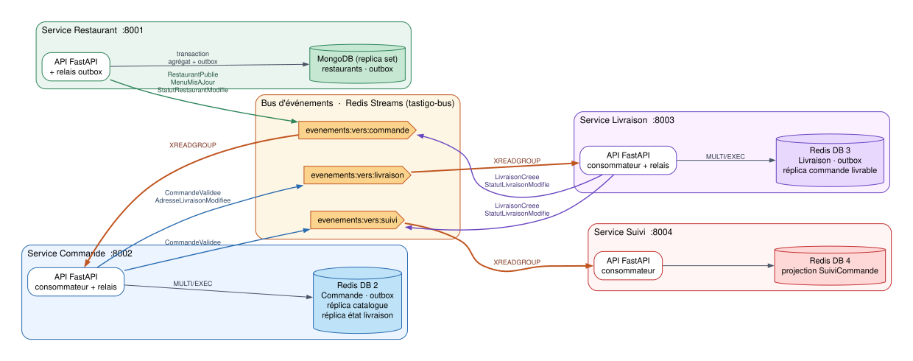

# Tastigo

Tastigo est une application pédagogique de livraison de repas. Un client consulte les restaurants, compose et valide une commande, puis suit sa livraison.

Le projet illustre un découpage en **services autonomes** : chaque service possède son agrégat et sa base NoSQL, les services échangent des **événements** sur un bus, et chacun conserve les **réplicas** dont il a besoin, mis à jour par ces événements.

Les **deux niveaux** du sujet sont livrés :

| Niveau | Contenu | Commande |
|---|---|---|
| 1 — sans programmation des services | MongoDB et Redis remplis par scripts (`mongosh`, `redis-cli`), réplicas mis à jour par événements, requêtes de consultation | `./niveau1/run.sh` |
| 2 — services programmés | 4 services Python / FastAPI qui utilisent MongoDB et Redis et s'échangent des événements sur un bus Redis Streams | `./scripts/demo.sh --reset` |

## Équipe et dépôt

- Idris — [@idris404](https://github.com/idris404)
- Rayan — [@issiakhemrayan](https://github.com/issiakhemrayan)
- Encadrant invité comme collaborateur avec accès en écriture — [@charroux](https://github.com/charroux)
- Dépôt — [github.com/idris404/Tastigo](https://github.com/idris404/Tastigo)
- Rapport — [`docs/rapport-tastigo.pdf`](docs/rapport-tastigo.pdf)

## Architecture



| Service | Port | Base | Agrégat propriétaire | Réplicas (alimentés par événements) |
|---|---|---|---|---|
| Restaurant | 8001 | MongoDB `tastigo_restaurant` | `Restaurant` (+ plats) | aucun |
| Commande | 8002 | Redis DB 2 | `Commande` (+ lignes) | catalogue des restaurants, état des livraisons |
| Livraison | 8003 | Redis DB 3 | `Livraison` | commande livrable (client, restaurant, total) |
| Suivi | 8004 | Redis DB 4 | projection `SuiviCommande` | résumé de commande + état de livraison |
| bus | 6380 | Redis Streams | — | une boîte de réception par service |
| interface | 8000 | nginx (page web) | — | aucune : appelle uniquement les API des services |

- **Restaurant → Commande** : `RestaurantPublie` crée le réplica du catalogue ; `MenuMisAJour` et `StatutRestaurantModifie` le mettent à jour.
- **Commande → Livraison** : `CommandeValidee` crée le réplica de la commande et la livraison ; `AdresseLivraisonModifiee` le met à jour.
- **Livraison → Commande** : `LivraisonCreee` et `StatutLivraisonModifie` tiennent à jour l'état de livraison connu de Commande.
- **Commande et Livraison → Suivi** : les mêmes événements construisent la projection client.

Détails : [services](docs/services.md) · [agrégats et réplicas](docs/aggregats.md) · [événements](docs/evenements.md) · [projection](docs/projection.md) · [bases NoSQL](docs/bases-nosql.md).

## Garanties mises en œuvre

| Garantie | Mécanisme |
|---|---|
| Publication fiable | outbox écrite dans la même transaction que l'agrégat (transaction MongoDB, `MULTI` Redis), puis relais vers le bus |
| Livraison au moins une fois | groupes de consommateurs Redis Streams, `XACK` après traitement, reprise des messages en attente |
| Idempotence | `SET evenements:traites` : un `eventId` déjà appliqué est ignoré |
| Ordre | `aggregateVersion` comparée à la `sourceVersion` du réplica |
| Concurrence | verrou optimiste : filtre sur `version` (MongoDB), `WATCH` (Redis) |
| Autonomie | chaque service décide sur ses propres données ; un service arrêté rattrape ses événements au redémarrage |
| Reconstruction | `POST /admin/reconstruire` rejoue les événements de Suivi |
| Traçabilité | `correlationId` commun à tout le parcours d'une commande ; rejets métier dans `evenements:rejetes` |

## Niveau 1 — bases remplies et interrogeables, sans service

Prérequis : Docker Desktop et un shell POSIX (Git Bash sous Windows).

```bash
./niveau1/run.sh
```

Le script n'utilise que `mongosh` et `redis-cli`, sur des bases séparées de celles du niveau 2 (MongoDB `tastigo_niveau1`, Redis DB 12 à 15) :

1. [`niveau1/mongodb/remplir.js`](niveau1/mongodb/remplir.js) crée les collections validées, les index, les 4 restaurants et 6 événements dans l'outbox ;
2. [`niveau1/mongodb/outbox-vers-redis.js`](niveau1/mongodb/outbox-vers-redis.js) relaie l'outbox : chaque événement est publié sur le flux `evenements:vers:commande` (DB 15) puis appliqué au réplica du catalogue de Commande (DB 12) dans un `MULTI`, avec son `eventId` mémorisé ;
3. [`niveau1/redis/scenario.redis`](niveau1/redis/scenario.redis) joue les échanges Commande → Livraison → Suivi : chaque émetteur modifie son agrégat et son outbox dans un même `MULTI`, l'événement passe par le bus, le récepteur met à jour son réplica ;
4. les requêtes MongoDB ([`mongodb/requetes.js`](mongodb/requetes.js)) et Redis ([`niveau1/redis/requetes.redis`](niveau1/redis/requetes.redis)) sont exécutées, puis 12 vérifications.

Résultat attendu : `NIVEAU1_OK bases=MongoDB+Redis restaurants=4 replicas=4 evenements=15`.

Les événements, versions et dates sont ceux de [`Events.json`](Events.json) : le niveau 1 montre « à la main » exactement ce que les services du niveau 2 font automatiquement.

## Niveau 2 — services programmés

Prérequis : Docker Desktop et Python 3 (bibliothèque standard uniquement, pour le scénario).

```bash
docker compose up -d --build --wait     # bases, bus et 4 services
python scripts/demo.py                  # scénario complet vérifié
```

Ou en une commande depuis Git Bash / Linux / macOS : `./scripts/demo.sh --reset` (repart de bases vides).

Au démarrage, le service Restaurant crée 4 restaurants **en passant par ses propres commandes** : les événements partent dans l'outbox et le catalogue répliqué de Commande se construit tout seul.

Résultat attendu de la démonstration (extrait) :

```text
=== 5. MenuMisAJour : le prix change dans Restaurant, le réplica suit, la commande reste figée
  [OK] réplica catalogue : Bowl falafel à 13,40 €
  [OK] cmd_1001 conserve le prix payé 12,90 € (snapshot)
...
=== 9. Reconstruction de la projection par rejeu des événements
  [OK] 4 événements rejoués, 1 suivis : projection identique
...
VALIDATION_OK verifications=23 commande=cmd_1001 livraison=liv_501 services=4 bases=MongoDB+Redis bus=RedisStreams
```

Pour voir les événements circuler en direct : `docker compose logs -f restaurant commande livraison suivi`.

### Interface de démonstration

Ouvrir **http://localhost:8000** une fois la pile démarrée.

La page montre les quatre services côte à côte, comme des tickets de cuisine : l'agrégat de chaque service, ses réplicas (avec un badge « à jour » qui compare la `sourceVersion` à la version de la source) et, en bas, le bus d'événements en direct. Tout ce qui change après un événement est **surligné en jaune**.

Un parcours guidé indique l'étape suivante : créer la commande, ajouter des plats depuis le réplica du catalogue, valider, changer l'adresse, affecter le livreur, passer en route puis livrée. Dans le ticket Restaurant, on peut modifier un prix, épuiser un plat, fermer un restaurant ou publier Burger Lab pour voir le réplica de Commande se mettre à jour. Les refus des règles métier (EN_ROUTE sans livreur, changement d'adresse après le départ…) s'affichent en rouge.

La page ([`interface/public/index.html`](interface/public/index.html), HTML et JavaScript sans dépendance) est servie par nginx, qui relaie `/api/<service>/` vers l'API du service : elle n'accède à aucune base directement.

## Interroger les bases

```bash
./mongodb/run-queries.sh    # 11 requêtes MongoDB : filtres, $unwind, texte, $group, outbox, explain, validation
./redis/run.sh              # lecture des clés Redis des 3 services et des flux du bus
```

Connexions directes : `mongodb://localhost:27017/?directConnection=true`, `redis://localhost:6379` (bases 2, 3, 4), `redis://localhost:6380` (bus).

Chaque API est documentée par FastAPI : http://localhost:8001/docs, :8002/docs, :8003/docs, :8004/docs.

### Exemple d'appels

```bash
# catalogue répliqué dans Commande
curl localhost:8002/catalogue/rest_42

# créer, remplir et valider une commande
curl -X POST localhost:8002/commandes -H 'Content-Type: application/json' -d '{"restaurantId":"rest_42","client":{"clientId":"cli_18","nom":"Camille Martin","telephone":"+33612000000","adresseLivraison":{"ligne1":"8 avenue Parmentier","codePostal":"75011","ville":"Paris"}}}'
curl -X POST localhost:8002/commandes/cmd_1001/lignes -H 'Content-Type: application/json' -d '{"platId":"plat_7","quantite":2}'
curl -X POST localhost:8002/commandes/cmd_1001/valider

# la livraison et le suivi ont été créés par événements
curl localhost:8003/commandes/cmd_1001/livraison
curl localhost:8004/suivis/cmd_1001
```

## Arborescence

```text
Tastigo/
├── README.md
├── Aggregates.json          agrégats, stockage physique, réplicas et invariants
├── Commands.json            commandes (API) et règles métier
├── Events.json              contrats d'événements (exemples réels) et flux
├── docker-compose.yml       MongoDB, Redis, bus Redis Streams, 4 services, interface
├── services/
│   ├── Dockerfile, requirements.txt
│   ├── common/              enveloppe d'événement, consommateur et relais d'outbox
│   ├── restaurant/          MongoDB : schéma, jeu de données, API
│   ├── commande/            Redis DB 2
│   ├── livraison/           Redis DB 3
│   └── suivi/               Redis DB 4
├── interface/               page de démonstration (public/index.html) + nginx.conf
├── niveau1/                 NIVEAU 1 sans service
│   ├── run.sh               remplissage, relais, scénario, requêtes, vérifications
│   ├── mongodb/remplir.js, outbox-vers-redis.js
│   └── redis/scenario.redis, requetes.redis
├── mongodb/requetes.js, run-queries.sh     requêtes communes aux deux niveaux
├── redis/requetes.redis, bus.redis, run.sh requêtes du niveau 2
├── scripts/demo.py, demo.sh                scénario vérifié du niveau 2
└── docs/
    ├── rapport-tastigo.pdf  mini rapport (source : rapport-tastigo.qmd, quarto render --to typst)
    ├── architecture.dot/.svg/.png
    ├── services.md, aggregats.md, evenements.md, projection.md, bases-nosql.md
    └── compte_rendu_mongodb_tastigo.md   compte rendu du TP MongoDB
```

## Exigences du projet

- [x] Au moins deux services : Restaurant, Commande, Livraison, Suivi
- [x] Au moins deux bases NoSQL : MongoDB et Redis (plus Redis Streams pour le bus)
- [x] Chaque service a son propre agrégat et sa propre base
- [x] Un service possède un réplica des données d'un autre : catalogue dans Commande, commande dans Livraison, état de livraison dans Commande, projection dans Suivi
- [x] Réplicas créés et mis à jour par échange d'événements
- [x] Niveau 1 : bases remplies et interrogeables sans service (`niveau1/run.sh`)
- [x] Niveau 2 : services programmés qui utilisent les bases (`scripts/demo.sh`)
- [x] Mini rapport PDF
