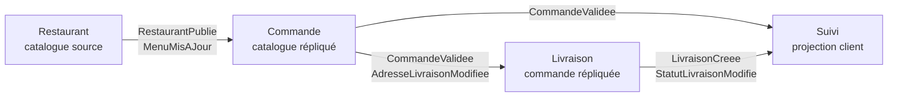
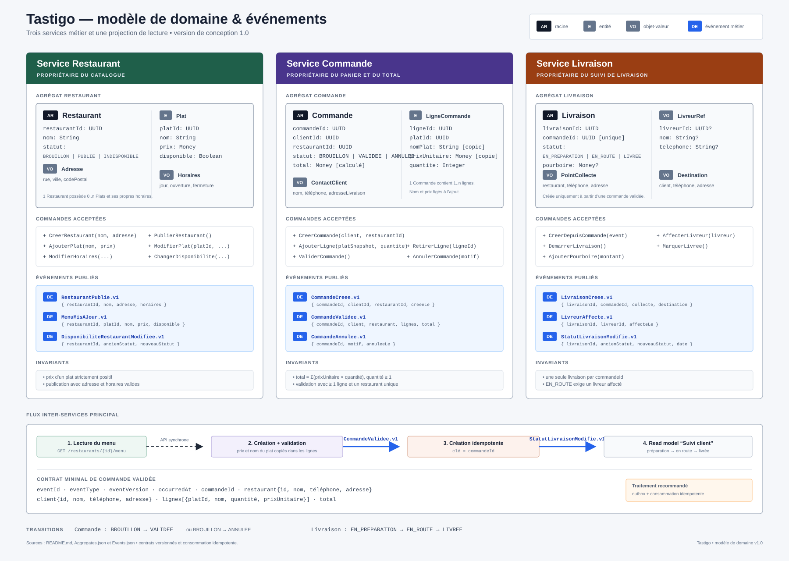

# Tastigo

Tastigo est une application pédagogique de livraison de repas inspirée des plateformes de livraison, avec un périmètre volontairement réduit. Un client consulte les restaurants et leurs menus, valide une commande, puis suit sa livraison.

Le projet illustre un découpage en services autonomes : chaque service possède ses données, échange des événements et conserve uniquement les réplicas nécessaires à son fonctionnement.

## Équipe et dépôt

- Idris — [@idris404](https://github.com/idris404)
- Rayan — [@issiakhemrayan](https://github.com/issiakhemrayan)
- Encadrant invité comme collaborateur avec accès en écriture — [@charroux](https://github.com/charroux) (acceptation en attente)
- Dépôt — [github.com/idris404/Tastigo](https://github.com/idris404/Tastigo)

## Parcours métier

1. Le service **Restaurant** publie les restaurants et leurs menus.
2. Le service **Commande** reçoit une copie des données de catalogue utiles, puis enregistre et valide les commandes.
3. Le service **Livraison** reçoit le snapshot d'une commande validée et organise son acheminement.
4. Le service **Suivi** transforme les événements reçus en une vue simple destinée au client.





## Services

| Service | Responsabilité | Données dont il est propriétaire | Données répliquées |
|---|---|---|---|
| Restaurant | Gérer les restaurants, horaires, plats, prix et disponibilités | `Restaurant`, `Plat` | Aucune |
| Commande | Constituer un panier, figer les prix et valider une commande | `Commande`, `LigneCommande` | Catalogue minimal des restaurants |
| Livraison | Affecter un livreur et faire progresser la livraison | `Livraison` | Snapshot de la commande, du client et du restaurant |
| Suivi | Préparer une vue de lecture pour le client | Projection `SuiviCommande` | Résumé de commande et état de livraison |

Le détail des frontières et des responsabilités se trouve dans [la définition des services](docs/services.md).

## Bases NoSQL

- **MongoDB — service Restaurant** : un restaurant, son adresse, ses horaires et ses plats sont conservés dans un même document. Ce modèle permet de lire un catalogue complet en une seule requête et correspond à la structure imbriquée de l'agrégat `Restaurant`.
- **Redis — services Commande et Livraison** : les agrégats sont représentés par des `HASH`, `LIST`, `SET` et `ZSET`. Redis convient aux lectures rapides par identifiant, aux index simples et aux changements de statut.

Chaque service reste propriétaire de ses données. La collection MongoDB `outbox` contient les événements Restaurant destinés au réplica de catalogue du service Commande.

## Agrégats et règles principales

- **Restaurant** est la racine du catalogue. Un plat appartient à un seul restaurant et son prix est strictement positif.
- **Commande** calcule `total = somme(prixUnitaire × quantite)`. Le nom et le prix du plat sont copiés au moment de l'ajout afin qu'un changement ultérieur du menu ne modifie pas une commande existante.
- **Livraison** est unique pour une commande. Elle ne peut passer à `EN_ROUTE` que si un livreur lui est affecté.
- **SuiviCommande** est une projection en lecture seule. Elle est reconstruisible à partir des événements.

Les exemples JSON complets sont dans [`Aggregates.json`](Aggregates.json) et leur explication dans [la documentation des agrégats](docs/aggregats.md).

## Découplage par événements

Les services ne lisent pas directement la base de données d'un autre service. Ils reçoivent des événements versionnés contenant uniquement les données nécessaires.

Chaque événement contient :

- le service émetteur et le service récepteur ;
- l'identifiant de l'agrégat concerné ;
- la donnée modifiée ;
- son ancienne valeur lorsqu'elle existe ;
- sa nouvelle valeur ;
- un identifiant d'événement, une version et une date.

Les contrats exécutables sont réunis dans [`Events.json`](Events.json). La matrice des flux, la création et la mise à jour des réplicas sont détaillées dans [la documentation des événements](docs/evenements.md).

## Projection vers le service Suivi

Le nouveau service **Suivi** ne recopie pas les agrégats tels quels. Il transforme :

- `CommandeValidee` en résumé de commande visible par le client ;
- `LivraisonCreee` en identifiant de livraison et statut initial ;
- `StatutLivraisonModifie` en statut courant et entrée de chronologie.

Cette vue évite au front-end d'interroger plusieurs services et reste reconstruisible. Le mapping complet est décrit dans [la documentation de projection](docs/projection.md).

## Garanties techniques retenues

- **Autonomie** : un service continue à lire ses réplicas si l'émetteur est temporairement indisponible.
- **Cohérence éventuelle** : une mise à jour peut mettre un court délai à apparaître dans le service récepteur.
- **Idempotence** : un `eventId` déjà traité est ignoré.
- **Ordre** : `aggregateVersion` empêche l'application d'un ancien événement après un nouveau.
- **Traçabilité** : `correlationId` relie les événements d'un même parcours métier.
- **Évolution** : le nom d'événement et `eventVersion` versionnent le contrat.

Dans une implémentation réelle, le producteur utiliserait un *outbox pattern* et chaque consommateur conserverait les identifiants déjà traités.

## Arborescence du livrable

```text
Tastigo/
├── README.md
├── Aggregates.json
├── Events.json
├── docker-compose.yml
├── mongodb/
│   ├── init/01_restaurants.js
│   ├── 02_requetes.js
│   └── run-queries.sh
├── redis/
│   └── 01_agregats.redis
└── docs/
    ├── services.md
    ├── agregats.md
    ├── evenements.md
    ├── projection.md
    ├── tastigo-aggregates-events.png
    └── tastigo-aggregates-events.svg
```

## Vérification locale

Les deux fichiers de contrat doivent être des JSON valides :

```bash
python3 -m json.tool Aggregates.json >/dev/null
python3 -m json.tool Events.json >/dev/null
```

Pour démarrer MongoDB, remplir automatiquement la base `tastigo_restaurant`, puis exécuter les requêtes de démonstration :

```bash
docker compose up -d mongodb
./mongodb/run-queries.sh
```

Les données MongoDB sont persistées dans le volume Docker `mongodb_data`. Pour forcer une nouvelle initialisation complète :

```bash
docker compose down -v
docker compose up -d mongodb
```

## État des étapes demandées

- [x] Étape 1 — idée, équipe, dépôt et description
- [x] Étape 2 — services et responsabilités
- [x] Étape 3 — agrégats définis en JSON
- [x] Étape 4 — services découplés, événements de création et de mise à jour des réplicas
- [x] Étape 5 — projection vers le nouveau service Suivi
- [x] Invitation GitHub envoyée à `charroux` avec accès en écriture (acceptation en attente)
