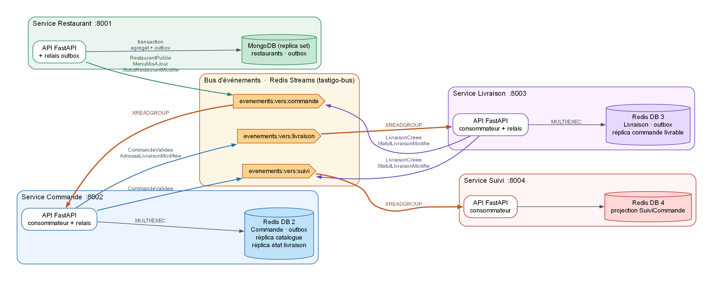

# Objet de l'application

Tastigo est une application de livraison de repas au périmètre volontairement réduit. Un client consulte les restaurants et leurs menus, compose et valide une commande, puis suit sa livraison jusqu'à la remise.

Le projet montre comment des services **autonomes** coopèrent sans partager de base de données : chaque service possède son agrégat et sa base NoSQL, publie des événements quand son agrégat change, et conserve localement une copie (réplica) des données des autres services dont il a besoin. Ces réplicas sont créés puis mis à jour **uniquement par échange d'événements**.

**Les deux niveaux du sujet sont livrés.**

- **Niveau 1, sans programmation des services** (`niveau1/run.sh`) : MongoDB et Redis sont remplis par des scripts `mongosh` et `redis-cli` ; les événements de l'outbox MongoDB sont relayés vers Redis et chaque échange Commande → Livraison → Suivi est rejoué commande par commande ; les bases sont ensuite interrogées.
- **Niveau 2, services programmés** (`scripts/demo.sh`) : quatre services Python (FastAPI) utilisent réellement MongoDB et Redis et s'échangent les événements sur un bus ; un scénario automatisé vérifie de bout en bout la création et la mise à jour des réplicas.

Les deux niveaux utilisent les mêmes structures de données et les mêmes contrats d'événements, sur des bases séparées.

| Exigence du sujet | Réalisation |
|------------------------|----------------------------------------------|
| Au moins deux services | Restaurant, Commande, Livraison, Suivi |
| Au moins deux bases NoSQL | MongoDB (Restaurant) et Redis (Commande, Livraison, Suivi), plus Redis Streams pour le bus |
| Un agrégat par service | `Restaurant`, `Commande`, `Livraison`, projection `SuiviCommande` |
| Un service a un réplica d'un autre | catalogue Restaurant dans Commande, commande dans Livraison, état de livraison dans Commande, résumé dans Suivi |
| Réplica mis à jour par événements | 7 types d'événements, 10 contrats (`Events.json`), outbox et bus Redis Streams |
| Niveau 1 : bases remplies et interrogeables | `niveau1/run.sh` : remplissage, relais, scénario, requêtes, 12 vérifications |
| Niveau 2 : services programmés | `services/` : 4 services FastAPI, scénario `scripts/demo.py`, 23 vérifications |

# Architecture

{width=100%}

| Service | Base | Agrégat propriétaire | Réplicas alimentés par événements |
|---|---|---|---|
| Restaurant (:8001) | MongoDB | `Restaurant` et ses plats | aucun |
| Commande (:8002) | Redis DB 2 | `Commande` et ses lignes | catalogue des restaurants ; état des livraisons |
| Livraison (:8003) | Redis DB 3 | `Livraison` | commande livrable (client, restaurant, total) |
| Suivi (:8004) | Redis DB 4 | projection `SuiviCommande` | résumé de commande et état de livraison |

Le parcours métier est le suivant : Restaurant publie son catalogue ; Commande le reçoit et vérifie les paniers sur sa copie locale ; à la validation, Livraison reçoit un instantané de la commande et crée la livraison ; Suivi assemble les événements de Commande et de Livraison en une vue unique pour le client. Aucun service n'appelle un autre service de manière synchrone et aucun ne lit la base d'un autre.

# Bases NoSQL utilisées et justification

## MongoDB pour le catalogue (service Restaurant)

L'agrégat `Restaurant` est un **document imbriqué** : adresse, horaires et plats appartiennent au restaurant et sont presque toujours lus ensemble (afficher une carte). MongoDB stocke ce document tel quel : une lecture renvoie le catalogue complet sans jointure, et toute modification de l'agrégat est une écriture atomique sur un seul document. La structure peut varier d'un restaurant à l'autre (catégories, horaires) ; le schéma flexible est encadré par un validateur `$jsonSchema` (champs obligatoires, prix strictement positif, code postal, énumération des statuts).

Les besoins de lecture du catalogue sont couverts par les index et le pipeline d'agrégation : index unique sur `restaurantId`, index composé `statut + adresse.ville`, index texte français sur le nom des plats, agrégations `$unwind` / `$group` pour les menus et les statistiques de prix. Enfin, MongoDB est lancé en *replica set* à un nœud pour disposer des **transactions multi-documents** : l'agrégat et l'événement à publier (collection `outbox`) sont écrits dans la même transaction.

## Redis pour Commande, Livraison et Suivi

Ces trois services manipulent de petits objets **lus et modifiés par identifiant**, avec des statuts qui changent souvent (`BROUILLON → VALIDEE`, `EN_PREPARATION → EN_ROUTE → LIVREE`). Redis, base clé-valeur en mémoire, répond en moins d'une milliseconde et offre des structures natives qui correspondent exactement aux besoins :

| Structure | Utilisation dans Tastigo |
|-------------|--------------------------------------------------------------|
| `HASH` | racine des agrégats, lignes de commande, réplicas, projection de suivi |
| `LIST` | ordre des lignes, historique des transitions, événements rejetés |
| `SET` | index par statut, plats d'un restaurant, `eventId` déjà traités (idempotence) |
| `ZSET` | commandes d'un client et chronologie de suivi, triées par date |
| `STREAM` | outbox locale de Commande et de Livraison |
| `STRING` + `INCR` | identifiants `cmd_1001`, `liv_501` |

`WATCH` / `MULTI` / `EXEC` fournit un verrou optimiste et des écritures atomiques sur plusieurs clés (agrégat + outbox + idempotence). La persistance AOF est activée. La projection Suivi, modèle de lecture reconstruisible, profite particulièrement d'un stockage en mémoire. Chaque service utilise sa propre base logique (2, 3 ou 4).

## Redis Streams pour le bus d'événements

Une instance Redis dédiée sert de broker. Les Streams apportent ce qu'il faut à une réplication fiable : groupes de consommateurs (`XREADGROUP`), acquittement explicite (`XACK`), reprise des messages délivrés mais non acquittés après une panne, et conservation de l'historique qui permet de **rejouer** les événements. Nous évitons ainsi d'ajouter Kafka ou RabbitMQ à un projet de cette taille.

## Pourquoi deux technologies

Un seul moteur aurait été possible, mais moins adapté : stocker le catalogue dans Redis obligerait à éclater chaque restaurant en dizaines de clés et à réécrire la recherche texte et les agrégations ; stocker les commandes dans MongoDB fonctionnerait, sans tirer parti des index et structures triées que Redis offre pour des accès par clé très fréquents. L'indépendance des services permet justement à chacun de choisir la base adaptée à son agrégat.

# Structures de données

## Document Restaurant (MongoDB, collection `restaurants`)

```json
{ "restaurantId": "rest_42", "nom": "Le Bistrot Vert", "telephone": "+33142000000",
  "adresse": { "ligne1": "12 rue des Lilas", "codePostal": "75011", "ville": "Paris" },
  "horaires": [ { "jour": "LUNDI", "ouverture": "11:30", "fermeture": "22:30" }, ... ],
  "statut": "PUBLIE",
  "plats": [ { "platId": "plat_7", "nom": "Bowl falafel", "categorie": "Plat",
               "prix": { "montant": 1290, "devise": "EUR" }, "disponible": true }, ... ],
  "version": 3 }
```

Les montants sont en centimes (entiers) pour éviter les erreurs d'arrondi. Le champ `version` est incrémenté à chaque commande : il sert de verrou optimiste (filtre de l'`updateOne`) et devient l'`aggregateVersion` des événements.

## Clés Redis des services

| Service | Clé | Type | Contenu |
|---------------|-----------------------------------|---------------|-----------------------------------|
| Commande | `commande:{id}` | HASH | statut, total, version, client et adresse aplatis |
| | `commande:{id}:lignes` / `:ligne:{lid}` | LIST / HASH | lignes avec **nom et prix figés** |
| | `commandes:client:{clientId}` | ZSET | commandes d'un client par date |
| | `catalogue:restaurant:{rid}`, `catalogue:plat:{rid}:{pid}` | HASH | **réplica** du catalogue (+ `sourceVersion`) |
| | `replica:livraison:{id}` | HASH | **réplica** de l'état de livraison |
| Livraison | `livraison:{lid}` / `:historique` | HASH / LIST | statut, livreur, version, transitions |
| | `livraisons:par-commande` | HASH | commande → livraison (une seule par commande) |
| | `replica:commande:{id}` | HASH | **réplica** : collecte, destination, total |
| Suivi | `suivi:{id}` / `:chronologie` | HASH / ZSET | projection et étapes datées |
| Tous | `outbox`, `evenements:traites`, `evenements:rejetes` | STREAM / SET / LIST | publication, idempotence, rejets |

Chaque réplica porte un champ `sourceVersion` : la dernière version de l'agrégat source qu'il a appliquée. Les invariants de chaque agrégat (une ligne au moins pour valider, total recalculé, livreur obligatoire pour partir, transitions autorisées…) sont décrits dans `Aggregates.json` et vérifiés par les services.

## Enveloppe d'un événement

```json
{ "eventId": "evt_f9877b64aa5942e98e08", "eventType": "MenuMisAJour", "eventVersion": 1,
  "occurredAt": "2026-11-16T14:57:54.889Z", "correlationId": "corr_rest_42",
  "emetteur": "restaurant", "recepteur": "commande",
  "aggregateId": "rest_42", "aggregateVersion": 3, "operationReplica": "METTRE_A_JOUR",
  "modification": {
    "donneeAgregatModifiee": "catalogueRestaurants[rest_42].plats[plat_7].prix",
    "cible": { "restaurantId": "rest_42", "platId": "plat_7", "champ": "prix" },
    "ancienneValeur": { "montant": 1250, "devise": "EUR" },
    "nouvelleValeur": { "montant": 1290, "devise": "EUR" } } }
```

Chaque événement indique l'émetteur, le récepteur, la donnée du réplica modifiée, son ancienne et sa nouvelle valeur. Les exemples de `Events.json` sont des événements réellement produits par les services.

# Réplication par événements

| Réplica | Émetteur → récepteur | Création | Mise à jour |
|---|---|---|---|
| Catalogue | Restaurant → Commande | `RestaurantPublie` | `MenuMisAJour`, `StatutRestaurantModifie` |
| Commande livrable | Commande → Livraison | `CommandeValidee` | `AdresseLivraisonModifiee` |
| État de livraison | Livraison → Commande | `LivraisonCreee` | `StatutLivraisonModifie` |
| Projection de suivi | Commande, Livraison → Suivi | `CommandeValidee` | `LivraisonCreee`, `StatutLivraisonModifie` |

**Publication fiable (outbox).** Un service n'écrit jamais directement sur le bus pendant une commande : il écrit l'événement dans sa propre base, dans la même transaction que l'agrégat (transaction MongoDB ou bloc `MULTI` Redis). Un relais recopie ensuite l'outbox vers la boîte de réception du récepteur, `evenements:vers:<service>`. Une modification ne peut donc pas être enregistrée sans son événement, ni l'inverse.

**Consommation.** Le récepteur lit sa boîte avec un groupe de consommateurs et n'acquitte qu'après avoir appliqué l'événement : la livraison est « au moins une fois ». Les doublons sont neutralisés par le `SET evenements:traites` (idempotence) et les événements anciens par la comparaison `aggregateVersion` / `sourceVersion` (ordre). Un événement refusé par une règle métier (par exemple un changement d'adresse arrivé après le départ du livreur) est acquitté et tracé dans `evenements:rejetes`.

**Projection Suivi.** Suivi ne recopie pas les agrégats : il garde le nom du restaurant sans ses coordonnées, calcule le nombre d'articles, traduit `EN_ROUTE` en « Votre commande est en route » et construit une chronologie triée par date (`ZSET`). Les événements de Commande et de Livraison peuvent arriver dans n'importe quel ordre ; un ancien statut ne remplace jamais un statut plus récent. La projection peut être supprimée puis reconstruite en rejouant les événements (`POST /admin/reconstruire`).

**Autonomie.** Commande refuse une commande sur un restaurant indisponible ou un plat épuisé, et refuse un changement d'adresse quand la livraison est partie, en consultant **uniquement ses réplicas**. Livraison organise l'acheminement sans jamais interroger Commande.

# Exécution et résultats

## Niveau 1 : sans service programmé

```bash
./niveau1/run.sh     # MongoDB tastigo_niveau1 + Redis DB 12 à 15, puis requêtes et vérifications
```

1. `remplir.js` crée les collections validées, les index, les quatre restaurants et six événements non publiés dans l'outbox.
2. `outbox-vers-redis.js` lit l'outbox dans l'ordre et génère, pour chaque événement, un `XADD` sur `evenements:vers:commande` puis un bloc `MULTI` qui met à jour le réplica du catalogue et mémorise l'`eventId` ; l'événement est ensuite marqué publié.
3. `scenario.redis` rejoue les échanges suivants : validation de la commande (agrégat + outbox), création du réplica et de la livraison, projection Suivi, changement d'adresse, affectation du livreur, `EN_ROUTE`, `LIVREE`. Chaque émetteur écrit son agrégat et son outbox dans un même `MULTI` ; chaque récepteur applique l'événement et mémorise son `eventId` dans un même `MULTI`.
4. Les requêtes MongoDB et Redis sont exécutées, puis 12 vérifications : prix répliqué 12,90 € en version 3, plat indisponible, restaurant fermé, brouillon non répliqué, adresse répliquée en version 4, suivi `LIVREE` avec quatre étapes, outbox vide. Le script se termine par `NIVEAU1_OK … evenements=15`.

## Niveau 2 : services programmés

```bash
docker compose up -d --build --wait     # MongoDB, Redis, bus et 4 services
python scripts/demo.py                  # scénario vérifié (23 contrôles)
./mongodb/run-queries.sh ; ./redis/run.sh   # interrogation directe des bases
```

Au démarrage, le service Restaurant crée quatre restaurants en passant par ses propres commandes (création, publication, changement de prix, de disponibilité, de statut) : le catalogue répliqué de Commande se construit donc par événements, comme en fonctionnement normal. Le restaurant resté en brouillon n'est jamais répliqué.

Résultats obtenus sur des bases vides :

- le réplica de chaque restaurant publié est identique à la source (version 3) ; un restaurant `INDISPONIBLE` refuse les commandes ;
- `cmd_1001` (2 bowls à 12,90 €, total 25,80 €) est validée en version 3 ; la livraison `liv_501` et son réplica sont créés en une dizaine de millisecondes ;
- le changement d'adresse met à jour le réplica de Livraison (`sourceVersion` 4) ; après le départ du livreur, Commande le refuse grâce à son réplica d'état de livraison ;
- le prix du bowl passe à 13,40 € dans Restaurant : le réplica suit, mais la commande conserve le prix payé de 12,90 € ;
- la chronologie de suivi contient `COMMANDE_VALIDEE → EN_PREPARATION → EN_ROUTE → LIVREE` ; un événement republié sur le bus est ignoré ; la projection reconstruite par rejeu est identique ;
- tous les événements observés respectent l'enveloppe de `Events.json`, l'outbox MongoDB est vide et aucun événement n'est rejeté. Le script se termine par `VALIDATION_OK verifications=23`.

Un test de panne a également été réalisé : avec le service Livraison arrêté, une commande validée reste en attente sur le bus (`lag 1`) ; au redémarrage, Livraison rattrape l'événement et crée la livraison, puis Suivi est mis à jour.

# Limites et perspectives

- Le relais de l'outbox MongoDB interroge la collection toutes les 0,5 s ; un *change stream* supprimerait cette latence.
- Les trois services Redis partagent une instance (bases logiques séparées) : l'isolation repose sur la configuration. En production, une instance par service serait préférable.
- Si une adresse est modifiée pendant que le statut `EN_ROUTE` est encore en transit, Livraison rejette l'événement et le trace, mais aucun événement de compensation n'informe Commande.
- Un seul consommateur par service, pas d'authentification ni d'interface graphique, et des flux du bus non tronqués (ils servent de journal pour le rejeu).
